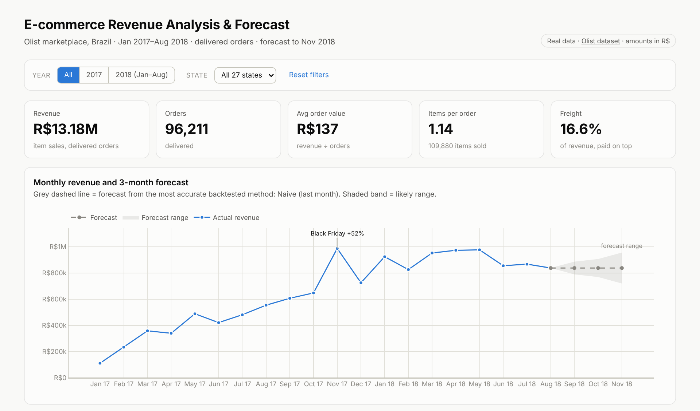
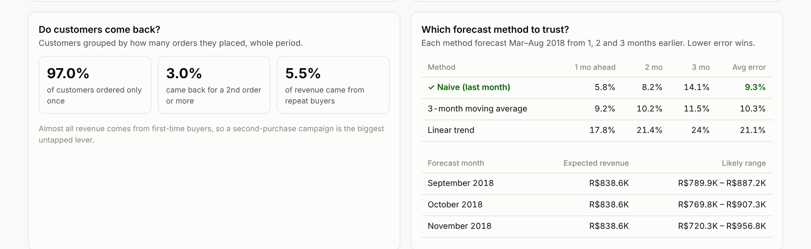

# E-commerce Revenue Analysis & Forecast

A revenue analysis of **96,211 real orders** from Olist, Brazil's largest online marketplace. It shows where the money comes from, how revenue changed over 20 months, and what the next 3 months will likely bring. The forecast method was chosen by testing it on months the model hadn't seen.

**Tools:** Python (Pandas, NumPy) · SQL (SQLite) · Plotly · Excel · Power BI (guide included)

### [▶ Open the live interactive dashboard](https://ayush-rag.github.io/ecommerce-revenue-analysis-/)



---

## Business questions

1. How much revenue did the store make, and is it still growing?
2. Which product categories, products and states drive revenue?
3. Do customers come back, and how do they pay?
4. What revenue should the business expect for the next 3 months, and how sure can we be?

## Key results

| Metric | Value |
|---|---|
| Revenue (Jan 2017 - Aug 2018) | R$13.18M |
| Delivered orders | 96,211 |
| Customers | 93,104 |
| Average order value | R$137 |
| Jan-Aug 2018 vs Jan-Aug 2017 | **+141%** |
| Forecast, Sep-Nov 2018 | about **R$839K a month** |

### Insights

1. **Fast growth, then a plateau.** Jan-Aug 2018 revenue (R$7.22M) was 141% higher than the same months of 2017 (R$2.99M). But monthly revenue peaked at R$977.5K in May 2018 and had fallen 14% to R$838.6K by August.
2. **Black Friday is the biggest event.** November 2017 revenue jumped 52% over October. 24 Nov 2017 alone brought R$149.9K, 2.5x the next best day.
3. **A few categories carry the business.** 18 of 74 categories (including "Unknown") make 80% of revenue. The top 3 (Health & beauty, Watches & gifts, Bed bath & table) bring 25.9%.
4. **80/20 rule holds.** 26% of products (8,310 of 32,081) generate 80% of revenue.
5. **Revenue is concentrated geographically.** São Paulo (SP), Rio de Janeiro (RJ) and Minas Gerais (MG) bring 63% of revenue, and SP alone 38%. In Pernambuco (PE), freight costs 23% of the order value, vs 17% overall.
6. **Customers rarely return.** 97% of customers ordered only once. Repeat buyers bring just 5.5% of revenue.
7. **Weekdays beat weekends.** Monday brings 16.4% of revenue and Saturday only 11.1%.
8. **Credit card dominates.** It pays for 78% of the money, split into 3.5 instalments on average.

### Recommendations

| Recommendation | Why |
|---|---|
| **Launch a second-purchase campaign** (discount on order 2, email reminders) | 97% of customers never return. Turning even 5% of them into repeat buyers would add revenue without new ad spend. |
| **Plan stock, staff and ads for Black Friday** | It's the year's biggest spike (+52% in November). The forecast below doesn't include it, so plan above it. |
| **Protect the top categories and products** | 26% of products make 80% of revenue. Keep them in stock and well listed. |
| **Look at shipping costs in the North and North-East** | Freight is 20% or more of order value in 14 states, including PE, CE, PA and MA, which likely holds back orders there. |
| **Investigate the 2018 slowdown** | Growth stopped after May 2018. Check marketing spend, prices and competition before it turns into a decline. |

---

## The forecast

Three simple methods were tested with a **walk-forward backtest**. For each of the last 6 known months (Mar-Aug 2018), every method forecast that month from 1, 2 and 3 months earlier, using only the data available at that time. This copies exactly how the real forecast is used.

| Method | 1 month ahead | 2 months | 3 months | Average error (MAPE) |
|---|---:|---:|---:|---:|
| **Naive (next month = last month)** ✓ | 5.8% | 8.2% | 14.1% | **9.3%** |
| 3-month moving average | 9.2% | 10.2% | 11.5% | 10.3% |
| Linear trend | 17.8% | 21.4% | 24.0% | 21.1% |

The linear trend was the worst because it assumed 2017's growth would continue, but revenue flattened in 2018. The simplest method won.

| Month | Forecast | Likely range |
|---|---:|---:|
| September 2018 | R$838.6K | R$789.9K - R$887.2K |
| October 2018 | R$838.6K | R$769.8K - R$907.3K |
| November 2018 | R$838.6K | R$720.3K - R$956.8K |

The range is ± the method's backtest error at that distance, so it widens the further ahead it looks. **Limitation:** with only one November in the data, the model can't learn the Black Friday spike, so November will likely come in above this forecast.



---

## How it works

```
Real Olist data: 5 CSV files, 99,441 orders
        │  src/clean_data.py
        ▼
Cleaning + translation                 → data/processed/
        │  src/load_database.py
        ▼
SQL database: 5 tables + a `sales` view
        │  src/run_analysis.py + src/forecast.py
        ▼
10 SQL queries + walk-forward forecast → outputs/ (CSVs, Excel, insights)
        │  src/build_dashboard.py
        ▼
Interactive dashboard                  → docs/index.html (GitHub Pages)
```

### 1. Data
The [Brazilian E-Commerce Public Dataset by Olist](https://www.kaggle.com/datasets/olistbr/brazilian-ecommerce) is **real, anonymised order data** from 2016-2018. Five of its files are used: orders, order items, customers, products and payments, plus the category translation file. They're stored compressed (`.csv.gz`) in `data/raw/`.

### 2. Data cleaning

| Check / problem | Rows | What was done |
|---|---:|---|
| Duplicate rows (all 5 files) | 0 | Checked, none found |
| Dates stored as text | 4 columns | Converted to real dates |
| Products with no category | 610 | Labelled "Unknown" |
| Categories missing an English name | 13 products | Translated by hand (`pc_gamer`, portable kitchen appliances) |
| Payments of type "not_defined" or R$0 | 9 | Removed |
| Delivered orders with no delivery date | 8 | Kept and flagged (revenue is still valid) |
| Orders not delivered (cancelled, unavailable, in progress) | 2,963 | Excluded from revenue |
| Orders in incomplete months (2016, Sep-Oct 2018) | 349 | Excluded from revenue |

### 3. SQL analysis
The data is loaded into 5 related tables ([schema](sql/01_create_tables.sql)). One **`sales` view** applies the revenue rule in a single place: delivered orders only, Jan 2017-Aug 2018, revenue = item price (freight separate). All 10 queries ([queries](sql/02_revenue_queries.sql)) read from it, using **4-table JOINs, a VIEW, CTEs, `LAG` for month-on-month and year-on-year growth, running totals with `SUM() OVER (ORDER BY …)` for the Pareto analysis, `RANK`, and `CASE`**.

### 4. Dashboard
`docs/index.html` is a single interactive page (works offline, hosted free on GitHub Pages). **Year** and **State** filters recalculate every KPI and chart. It includes the revenue trend with forecast band, top categories, top states, weekday split, payment methods, customer loyalty and the forecast backtest.

### 5. Excel report
`outputs/revenue_report.xlsx` has 14 sheets, one per analysis, including the full forecast backtest.

### 6. Power BI version
[`powerbi/POWER_BI_GUIDE.md`](powerbi/POWER_BI_GUIDE.md) explains how to rebuild the dashboard in Power BI, with all DAX measures.

---

## Project structure

```
ecommerce-revenue-analysis-/
├── main.py                        # runs the full pipeline
├── requirements.txt
├── src/
│   ├── config.py                  # paths and forecast settings
│   ├── clean_data.py              # 1. clean + translate
│   ├── load_database.py           # 2. load into SQLite
│   ├── run_analysis.py            # 3. SQL queries, insights, Excel
│   ├── forecast.py                # 4. walk-forward backtest + forecast
│   ├── build_dashboard.py         # 5. HTML dashboard
│   └── dashboard_template.html
├── sql/
│   ├── 01_create_tables.sql       # 5 tables + the `sales` view
│   └── 02_revenue_queries.sql     # 10 analysis queries
├── data/
│   ├── raw/                       # original Olist files (.csv.gz)
│   └── processed/                 # cleaned tables (.csv.gz)
├── outputs/
│   ├── revenue_report.xlsx
│   ├── insights.md
│   ├── forecast.csv
│   ├── forecast_backtest.csv      # all 54 backtest predictions
│   ├── forecast_method_scores.csv
│   ├── cleaning_log.csv
│   └── sql_results/               # one CSV per SQL query
├── docs/index.html                # interactive dashboard (GitHub Pages)
├── powerbi/POWER_BI_GUIDE.md
└── images/                        # screenshots
```

## How to run

```bash
git clone https://github.com/Ayush-rag/ecommerce-revenue-analysis-.git
cd ecommerce-revenue-analysis-
pip install -r requirements.txt
python main.py
```

The pipeline takes about 20 seconds. Then open `docs/index.html` in your browser.

**Using MySQL instead of SQLite:** replace `strftime('%Y-%m', x)` with `DATE_FORMAT(x, '%Y-%m')` and `strftime('%w', x)` with `DAYOFWEEK(x) - 1`. Everything else works in MySQL 8.

## Skills demonstrated

- **Data cleaning** on a real, multi-table dataset: type conversion, missing values, translation, validation
- **SQL:** relational schema, multi-table joins, views, CTEs, window functions (`LAG`, running totals, `RANK`)
- **Revenue analytics:** growth rates, like-for-like comparison, Pareto analysis, AOV, customer retention, payment mix
- **Forecasting:** comparing methods with a walk-forward backtest, error ranges, stating limitations
- **Communication:** interactive dashboard, Excel report, recommendations tied to numbers

## Data source and licence

Data: [Brazilian E-Commerce Public Dataset by Olist](https://www.kaggle.com/datasets/olistbr/brazilian-ecommerce), released by Olist under [CC BY-NC-SA 4.0](https://creativecommons.org/licenses/by-nc-sa/4.0/). It's used here for non-commercial educational purposes. Amounts are in Brazilian reais (R$).

---

**Ayush Raghav** · B.Tech CSE, Manipal University Jaipur · ayushraghav.work@gmail.com
